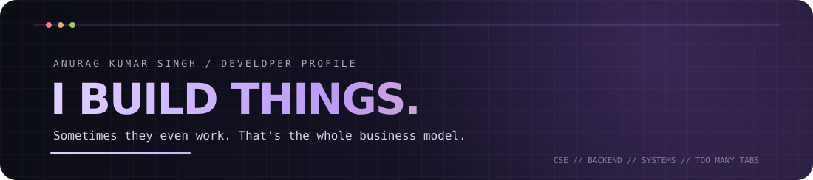
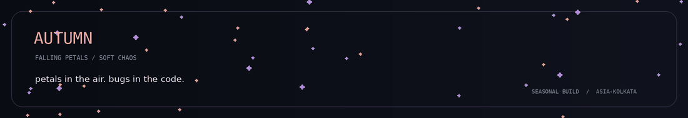
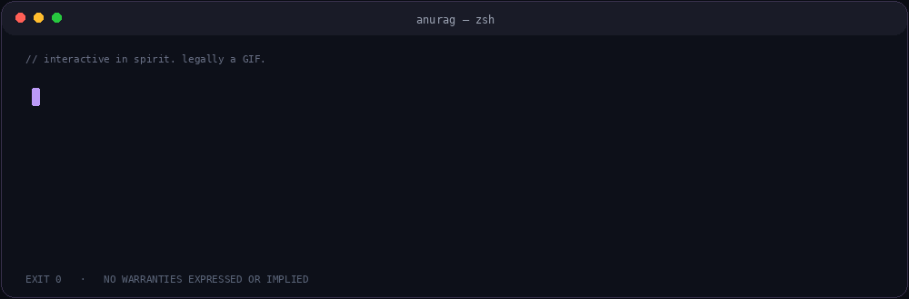
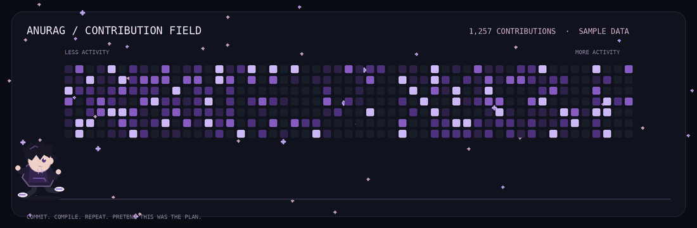

<div align="center">
  
  <br />
  
  <br />
  <a href="https://github.com/anuragdevcode"></a>
  <a href="https://x.com/ohnoanurag"></a>
  
  <br /><br />
  <a href="#about"><code>whoami</code></a> ·
  <a href="#projects"><code>ls ~/projects</code></a> ·
  <a href="#toolbox"><code>cat toolbox.json</code></a> ·
  <a href="#contact"><code>ping anurag</code></a>
</div>

## `whoami` <a id="about"></a>

Computer Science student, builder of backend systems, and enthusiastic collector of problems that did not need to exist.

I like understanding what happens behind the UI: APIs, queues, databases, deployment pipelines, concurrency, and the occasional mysterious process consuming 97% CPU.

```yaml
role: Software Engineer in the making
education: B.Tech — Computer Science & Engineering
location: Dehradun, India
interests: [Backend Engineering, Systems, Distributed Systems, AI]
current_loop: Learn → Build → Break → Debug → Pretend it was intentional
```

> I enjoy turning coffee into software and software into new reasons to drink coffee.

## `./terminal` — a highly interactive simulation

<table>
  <tr>
    <td width="72%" align="center" valign="middle">
      
    </td>
    <td width="28%" align="center" valign="middle">
      
    </td>
  </tr>
</table>

The GIF is the terminal animation. The command shortcuts above are the clickable bits. GitHub README pages don't execute custom JavaScript, so no fake input box pretending to be a real shell. We have standards. Barely.

## `ls ~/projects` <a id="projects"></a>

| Project | What it does | Stack |
|---|---|---|
| **[DeployForge](https://github.com/anuragdevcode/PBL_deploy_forge)** | Lightweight PaaS: connect a GitHub repo, build it, deploy it, get a public URL. | Node.js · React · PostgreSQL · Redis · Docker · Nginx · C++ |
| **ScaleFlow** | Java load balancer with Round Robin, Least Connections, Weighted routing, sockets and health checks. | Java · Sockets · Concurrency |
| **[NeuroNav](https://github.com/anuragdevcode/Autonomous-Vehicle-Simulation-using-Neural-Networks)** | Autonomous vehicle navigation experiments using neural networks and simulation. | Python · Neural Networks |
| **[LogicLab](https://github.com/anuragdevcode/LogicLab)** | A playground for logic, algorithms and problem-solving experiments. | Programming · Algorithms |
| **[Tangent](https://anuragdevcode.github.io/Tangent/)** | Live-wallpaper and desktop-customization experiment for macOS. | Swift · AppKit · macOS |

## `./contribution-runner` — no snakes were harmed

<div align="center">
  
</div>

An original little anime developer sprints under the contribution grid while the activity levels glow above. The graph is fetched from GitHub; the character is not being paid enough for this.

## `cat toolbox.json` <a id="toolbox"></a>

<div align="center">
  
</div>

**Currently interested in:** backend engineering, distributed systems, system design, AI infrastructure, and making developer tools less annoying.

## `ping anurag` <a id="contact"></a>

Open to internships, paid projects, collaborations, and conversations about building software that solves actual problems.

<div align="center">
  <a href="https://github.com/anuragdevcode"></a>
  <a href="https://x.com/ohnoanurag"></a>
  <br /><br />
  <sub>“It was working yesterday.” — every developer, including the one who changed nothing.</sub>
</div>
