<!--
  Anurag Kumar Singh · GitHub profile README · v3
  The falling things are generated by scripts/generate_profile.py and refreshed
  by .github/workflows/refresh-profile.yml. They follow Dehradun's actual weather.
  If you're reading the source: hello. `sudo hire anurag` is near the bottom.
-->

<div align="center">



<br/>

<a href="https://github.com/anuragdevcode"></a>
<a href="https://x.com/ohnoanurag"></a>


<br/><br/>

<a href="#about"><code>whoami</code></a> ·
<a href="#terminal"><code>./terminal</code></a> ·
<a href="#projects"><code>ls ~/projects</code></a> ·
<a href="#runner"><code>./contribution-runner</code></a> ·
<a href="#toolbox"><code>cat toolbox.json</code></a> ·
<a href="#contact"><code>ping anurag</code></a>

</div>


<table>
<tr>
<td valign="top" align="center"><picture><source media="(max-width: 700px)" srcset="assets/rail-blank.svg"></picture></td>
<td valign="top">

<picture><source media="(max-width: 700px)" srcset="assets/desk-96.gif"></picture>

## `whoami` <a id="about"></a>

Computer Science student, backend enthusiast, and collector of problems that did not need to exist.

I like understanding what happens behind the interface: APIs, queues, databases, deployment pipelines, concurrency, and the occasional process quietly eating 97% of the CPU.

**I don't just want to use technology. I want to understand how it's built.**

</td>
<td valign="top" align="center"><picture><source media="(max-width: 700px)" srcset="assets/rail-blank.svg"></picture></td>
</tr>
</table>


```yaml
name: Anurag Kumar Singh
role: Software Engineer in the making
education: B.Tech CSE, Graphic Era Deemed to be University
location: Dehradun, India
focus: [Backend, Distributed Systems, System Design, AI, Developer Tools]
open_to: [internships, freelance work, collaborations]
life_motto: "If it works, don't touch it. If it doesn't, add logs."
```


<table>
<tr>
<td valign="top" align="center"><picture><source media="(max-width: 700px)" srcset="assets/rail-blank.svg"></picture></td>
<td valign="top">

## `./terminal` <a id="terminal"></a>



<sub>It looks interactive. It's an SVG. GitHub READMEs can't run JavaScript, so there's no fake input box pretending to be a shell. We have standards. Barely. The weather line is real: it re-renders every few hours from Dehradun's actual sky.</sub>

</td>
<td valign="top" align="center"><picture><source media="(max-width: 700px)" srcset="assets/rail-blank.svg"></picture></td>
</tr>
</table>


<table>
<tr>
<td valign="top" align="center"><picture><source media="(max-width: 700px)" srcset="assets/rail-blank.svg"></picture></td>
<td valign="top">

## `ls ~/projects` <a id="projects"></a>

<sub>Things I've built instead of making yet another weather app. (The weather is a separate matter.)</sub>

### ⚡ DeployForge

**Lightweight PaaS & deployment platform.** Inspired by Render and Vercel: connect a GitHub repository, trigger a build, deploy the app and get a public URL.



- PostgreSQL-backed deployment lifecycle
- Redis Streams and background workers for builds
- Docker-based execution
- Nginx reverse proxy with dynamic routing
- Node.js backend with a React frontend

`Node.js` `React` `PostgreSQL` `Redis` `Docker` `Nginx` `C++`

[↗ Repository](https://github.com/anuragdevcode/PBL_deploy_forge)

### ⚖️ ScaleFlow

**Java load balancer.** Because sending every request to the same server is apparently not a great scaling strategy.



- Round Robin, Least Connections and Weighted scheduling
- Socket-based communication
- Concurrent request handling
- Health checks

`Java` `Sockets` `Multithreading` `Concurrency`

[↗ Repository](https://github.com/anuragdevcode/ScaleFlow)

### 🧰 More experiments

- 🧠 **[NeuroNav](https://github.com/anuragdevcode/Autonomous-Vehicle-Simulation-using-Neural-Networks)**: autonomous vehicle simulation, exploring neural networks and navigation. `Python` `Neural Networks` `Simulation`
- 🧪 **[LogicLab](https://github.com/anuragdevcode/LogicLab)**: a playground for logical thinking, algorithms and experiments that don't belong anywhere else. `Algorithms` `Problem Solving`
- 🌌 **[Tangent](https://anuragdevcode.github.io/Tangent/)**: live wallpapers for macOS, a native take on animated backgrounds because static desktops are boring. `Swift` `AppKit` `macOS`

</td>
<td valign="top" align="center"><picture><source media="(max-width: 700px)" srcset="assets/rail-blank.svg"></picture></td>
</tr>
</table>


<table>
<tr>
<td valign="top" align="center"><picture><source media="(max-width: 700px)" srcset="assets/rail-blank.svg"></picture></td>
<td valign="top">

## `./contribution-runner` <a id="runner"></a>



<sub>Real contribution data, refreshed by a GitHub Action. The mascot punches commits and squares from the real calendar light up on every hit. No commits were harmed. Several were fixed.</sub>

</td>
<td valign="top" align="center"><picture><source media="(max-width: 700px)" srcset="assets/rail-blank.svg"></picture></td>
</tr>
</table>


## `cat toolbox.json` <a id="toolbox"></a>

<div align="center">

<b>Languages</b><br/>
<br/><br/>
<b>Backend & infrastructure</b><br/>
<br/><br/>
<b>Frontend & tools</b><br/>


</div>


<table>
<tr>
<td valign="top" align="center"><picture><source media="(max-width: 700px)" srcset="assets/rail-blank.svg"></picture></td>
<td valign="top">

## `ping anurag` <a id="contact"></a>

Have an interesting idea? Need something built? Want to discuss systems, software, or why your code works locally but not in production?

I'm open to **internships, collaborations and freelance projects.** Things I can build for you:

- ⚙️ Backend APIs and services (Node.js, Java, PostgreSQL, Redis)
- 🚀 Deployment pipelines and Docker-based tooling
- ⚖️ Concurrent, socket-level and load-balancing systems
- 🧠 Python-based AI and simulation experiments
- 🍎 Native macOS apps in Swift

</td>
<td valign="top" align="center"><picture><source media="(max-width: 700px)" srcset="assets/rail-blank.svg"></picture></td>
</tr>
</table>


```bash
$ sudo hire anurag
[sudo] password for recruiter: ********
✔ anurag has joined your team. Coffee budget: unlimited.
```

<div align="center">

<a href="https://github.com/anuragdevcode"></a>
<a href="https://x.com/ohnoanurag"></a>

<h3>"It was working yesterday."</h3>
<i>— Every developer, eventually.</i>

</div>


<div align="center">

<sub>The falling things follow Dehradun's weather (data by <a href="https://open-meteo.com/">Open-Meteo</a>) and refresh every few hours via GitHub Actions.<br/>Designed with curiosity, caffeine, and an unreasonable number of open browser tabs.</sub>

</div>
